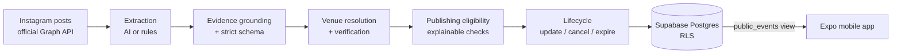

# PLUP — AI-powered event discovery for Metro Manila

PLUP is a mobile app (iOS and Android) that shows concerts, DJ sets, live music, festivals and nightlife on an interactive map of Metro Manila, together with a backend pipeline that turns Instagram event announcements into verified, mappable events. No user account is required to browse.

> **Status: early stage.** The app currently runs on demo data. The ingestion pipeline, AI extraction layer and Supabase schema are built and tested, but unattended publishing is **off by design** and the database schema has **not yet been applied to a live project**. See [Project status](#project-status) for exactly what is and isn't done.

PLUP is an independent project and is not affiliated with or endorsed by Instagram, Meta, Google or Anthropic. All demo events, venues and artists in this repository are fictional.

## Features

**Mobile app (Expo / React Native)**
- Interactive map with an event pin for each listing, a preview card and a full details screen
- Filters by date (tonight, weekend, calendar day), distance from you or a chosen place, music genre, and free-text search
- Event details with date, venue, lineup, ticket link, the original Instagram source link and external sharing
- Honest uncertainty: unknown start times and prices stay unknown, and unverified listings are labelled
- Light, rounded, minimalist design; no accounts

**Event ingestion pipeline (Node + TypeScript, in `ingestion/`)**
- **Extraction:** Instagram caption → classification (upcoming event, recap, unrelated, ambiguous) and structured fields (title, artists, date, start time, venue, tickets). A rules extractor is the fallback; an AI extractor plugs in behind a small `LlmClient` interface (Gemini and Claude clients included).
- **Grounding:** every fact the model returns must be supported by the caption itself (checked in code). Unsupported claims are dropped and logged, never published. Captions are treated as untrusted input; the model's own confidence is never used.
- **Venue verification:** names are normalized, matched exactly (never fuzzily), and confirmed from independent sources before a pin is placed; only Metro Manila venues are accepted.
- **Publishing eligibility:** a list of explainable checks (date, venue, name reliability, cancellations, duplicates, AI output cleanliness) decides reject / hold / eligible. Nothing is published unless an explicit master switch is turned on.
- **Lifecycle:** events can be updated, cancelled, unpublished or expired, with full provenance (source links and audit history).
- **Persistence:** idempotent writes to PostgreSQL (Supabase) behind a storage interface, with Row Level Security so mobile users can read only published events.

## Architecture



- The **app** reads only a public, read-only view of published events (anonymous/publishable key).
- The **ingestion service** is server-side only. It holds the privileged keys (Supabase service role, model API keys) and is never bundled into the app.
- Details: [`ingestion/README.md`](ingestion/README.md) (pipeline), [`supabase/README.md`](supabase/README.md) (schema and privacy model).

## Tech stack

| Area | Technology |
|---|---|
| App | Expo SDK 57, React Native 0.86, React 19, TypeScript, Expo Router, react-native-maps |
| Backend | Supabase (PostgreSQL, Row Level Security) |
| Ingestion | Node.js 22.18+ (TypeScript run directly, no build step), `node:test` |
| AI | Google Gemini (free tier) and Anthropic Claude clients behind one interface; deterministic rules fallback |
| Quality | TypeScript strict mode, 193 automated tests |

## Getting started

**Prerequisites:** Node.js 22.18 or newer (24 recommended), npm, and the Expo Go app or a simulator.

```bash
npm install
cp .env.example .env.local   # optional: public Supabase URL + publishable key; without them the app uses demo data
npx expo start               # then open in Expo Go, iOS Simulator or Android Emulator
```

`.env.local` is git-ignored. Only public values belong in `EXPO_PUBLIC_*` variables; never put a service-role or model API key there.

### Ingestion service (optional, server-side)

```bash
# Server keys are read from environment variables (names in ingestion/.env.example):
# SUPABASE_URL, SUPABASE_SERVICE_ROLE_KEY, GEMINI_API_KEY. Set them in your shell, never in the app.
npm run ingest:demo                        # run the pipeline on fictional fixtures and print JSON
npm run ingest:eval-live                   # dry run of a live model evaluation (sends nothing without --confirm-spend)
```

Real Instagram data and evaluation outputs are kept in `ingestion/local/`, which is git-ignored. Supabase setup (migration, RLS, server variables) is described in [`supabase/README.md`](supabase/README.md).

## Testing

```bash
npm run ingest:test    # 193 tests
npx tsc --noEmit       # TypeScript type check
```

All 193 automated tests pass and TypeScript reports zero errors. The tests cover date and time handling (Asia/Manila), classification, extraction and grounding, venue normalization and verification, publishing eligibility, the event lifecycle, the AI clients (with mocked HTTP; no real API calls), idempotent persistence (run against both an in-memory store and a fake PostgREST), static checks of the SQL's privacy rules, and repository hygiene (no secrets or real third-party data are committed).

## Project structure

```
src/            Expo app (routes in src/app, data and hooks, UI components)
ingestion/      Server-side event ingestion: extraction, grounding, venues, publishing, persistence, tests
supabase/       PostgreSQL migration with Row Level Security and the public events view
assets/         App icons and images
```

## Project status

| Area | State |
|---|---|
| Map app (filters, details, sharing) | Working on demo data |
| Rules and AI extraction | Built and tested; a live Gemini run on 10 real posts classified all 10 correctly (a tiny sample, not a benchmark) |
| Venue verification | Built; one verified venue seeded, further venues need a production lookup provider |
| Publishing eligibility and lifecycle | Built and tested; unattended publishing disabled |
| Supabase persistence | Built and tested against fakes; SQL not yet run on a live database |
| Showing real events in the app | Not yet; the app does not read from Supabase |

## Security and privacy

- No secrets are committed; env files and local data are git-ignored and a test enforces this.
- Row Level Security keeps candidates, source posts, logs and caches private; the mobile roles can read only published events.
- Instagram data is collected through the official API only. Raw captions are never committed.
- To report a security issue, please open a private security advisory on the repository.

## License

MIT. See [`LICENSE`](LICENSE). Portions originate from the Expo project template.
